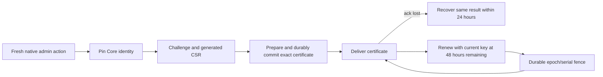
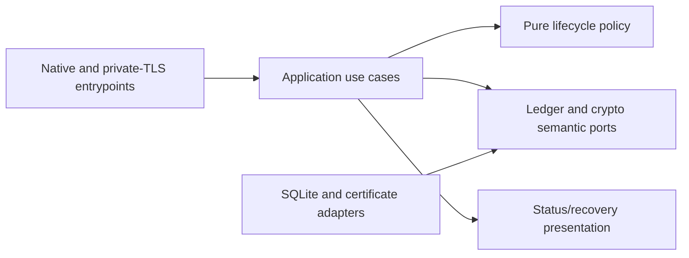

# Home Assistant OAuth Pairing Lifecycle

- Status: Draft (proposed companion; parent remains Draft)
- Date: 2026-10-31
- Catalog capability ID: `home-assistant-oauth-companion`
- Last verified: not applicable (prospective lifecycle contract; existing evidence is cited below)
- Owners: Symphonia maintainers
- Scope: Specify durable native Home Assistant OAuth companion pairing, renewal, delivery recovery, and key-loss boundaries, with separate nonproduction persistence research.
- Related issues/PRs: [Issue #40](https://github.com/vypdev/symphonia/issues/40), PRs #35 and #39, [parent companion SDD](home-assistant-oauth-companion.md)
- Required review gates: product UX, architecture, testing, documentation, security/operations, Home Assistant platform review for proposed destructive recovery authority
- Open decisions blocking readiness: Signed reset/resume approval is proposed only and blocked on security, Home Assistant, and UX review; offline recovery procedure and supported HAOS UX remain unimplemented. The parent remains Draft pending its existing readiness gates.

> This is a lifecycle appendix to `specs/home-assistant-oauth-companion.md`. The parent owns native OAuth behavior and its 80 production and 16 live acceptance cases. This appendix adds no production readiness claim and does not alter the parent budgets. Its separate 24-case budget is for offline, nonproduction laboratory research only.

## 1. Executive summary

A native Home Assistant App pairs once with Core using a short-lived challenge and a narrowly scoped installation identity. The App pins Core's identity before it sends the challenge. Core prepares and durably commits the exact certificate and admission record before delivery. If delivery is lost, an authorized retry may retrieve that identical certificate during a bounded recovery window; it cannot mint another identity or restore general authority. Renewal proves possession of the current admitted key, preserves the pair and authority, and is serialized against revocation and reset.

The recommended model starts automatically only when the App and Core retain their expected private keys. Missing or mismatched keys lock credentials and the private channel; startup never silently rekeys. The research increment exercises crash, retry, replay, and race behavior with synthetic credentials and SQLite in `tools/ha_oauth_companion_lab`. It is not production implementation or evidence that production gates pass.

```text
Native active-admin action -> pin Core identity -> one-use challenge -> durable certificate admission -> deliver exact certificate -> prove current key for renewal
```

## 2. Problem, current behavior, and evidence

### 2.1 Problem

An owner or operator needs pairing to survive ordinary restarts and delivery failures without repeated consent, duplicate identities, or renewal after revocation. Current evidence does not establish a durable production protocol for acknowledgement recovery, serialized renewal/revocation, or accepted destructive recovery authority. Treating an in-memory or issue-after-commit result as recoverable can strand a pair or issue multiple identities.

### 2.2 Current behavior

Verified evidence, not proposed behavior:

1. The owner-instance native My/HA OAuth trial succeeded and was fully removed.
2. Existing isolated research demonstrates native hooks, generated CSR issuance, some renewal behavior, and key-loss/reset boundaries.
3. PR #39 records unresolved production gaps. The merged 20-minute trial is evidence, not a production release.
4. The existing owner SDD and catalog identify the capability and current research evidence; catalog paths do not establish future implementation or framework execution support.

The lifecycle below is proposed and has not been implemented or production-validated.

### 2.3 Evidence

- Code/workflow/documentation references: `specs/home-assistant-oauth-companion.md`; `docs/development/native-oauth-production-readiness-2026-10-30.md`; `docs/development/native-oauth-trial-acceptance-2026-10-30.md`; `tools/ha_oauth_companion_lab/README.md`; `tests/test_ha_oauth_companion_lab.py`; workflow `.github/workflows/verify.yml`.
- Incidents or concrete examples: lost delivery after commit, process restart, competing renewal and revocation, stale request replay, App key loss, and loss of Core identity are the relevant failure examples to research. No production incident is asserted.
- External primary sources: Home Assistant native App/Core APIs and platform documentation must be recorded and reviewed by the implementation; this draft does not claim platform review has occurred.
- Unknowns: production package conformance, platform support for the proposed operator recovery UX, and accepted signed reset/resume authority.

### 2.4 Retrospective classification (as-built baselines only)

Not applicable: this is a prospective appendix and does not reconstruct an implemented baseline. Existing observations above remain evidence only.

## 3. Actors, surfaces, and terminology

| Actor | Goal | Entry point | Visible surfaces |
|---|---|---|---|
| App owner | Pair the App and authorize initial OAuth | Fresh native active-admin action | Native App, pairing status, recovery guidance |
| App process | Use its admitted installation identity and renew | Private Core-to-App TLS channel | App health/status and private channel |
| Core | Admit, renew, revoke, and retain durable identity state | Native Core service | Operator diagnostics and durable ledger |
| Operator | Restore service safely after key/trust loss | Authenticated recovery guidance | Home Assistant operator documentation |
| Maintainer/reviewer | Validate proposed contract and research | PR, checks, RFC/ADR, lab report | GitHub issue/PR, workflow summary, docs |

Terms: **pair** is one admitted App installation identity; **epoch** is its monotonic authority generation; **leaf** is a short-lived client certificate; **delivery recovery** retrieves a previously committed certificate and grants no general authority; **trust anchor** is the previously enrolled public Core authority; **fence** is a durable generation/serial condition that makes stale credentials unusable. Core owns admission facts; the App owns its private key. The ledger contains no raw challenge or provider secret.

## 4. Goals

| Requirement | Behavior |
|---|---|
| LIF-01 | Pin the Core App identity before sending a one-use pairing challenge over the private Core-to-App TLS channel. |
| LIF-02 | Require a fresh native active-admin action for initial pairing, OAuth confirmation, revocation, and destructive recovery. Network proximity and cached Ingress actor headers never establish fresh authority. |
| LIF-03 | Generate local keys and use server-controlled certificate identity/extensions. Prepare the exact certificate before committing admission. |
| LIF-04 | Atomically persist consumed challenge, request/CSR identity, pair/epoch, serial, and exact public certificate before delivery; retries return only that exact committed result. |
| LIF-05 | Bind renewal to old admitted certificate/key, replacement CSR, pair/epoch, and unique request; serialize renewal against revocation/reset with a durable generation/serial fence. |
| LIF-06 | Reject revoked, expired, stale, or wrong-generation identities for general RPC and renewal, including retries. |
| LIF-07 | Apply bounded lifetime, retry, recovery, capacity, and tombstone retention rules without evicting live authority or preventing revocation. |
| LIF-08 | Start automatically only with expected keys; missing/wrong keys lock credentials and private channel without silent rekey, while nonsecret history and authenticated guidance remain available. |
| LIF-09 | Distinguish App-key loss with retained trusted Core identity from Core identity/trust-anchor loss; never substitute an Ingress header for an absent anchor. |
| LIF-10 | Specify signed reset/resume only as a proposed, acceptance-blocked design; require purpose, one-use, expiry, prior enrolled authority, and separate reset/resume semantics. |
| LIF-11 | Limit the research increment to 24 offline cases in `tools/ha_oauth_companion_lab` and tests, using real generated P-256 CSRs/certificates, SQLite persistence, and synthetic credentials. |
| LIF-12 | Preserve the parent capability, its 80 production / 16 live cases and the neighboring 82 authorization / 58 runtime budgets; research neither adds to nor completes them. |

### 4.1 Goals

The measurable outcomes are the LIF requirements above: one durable identity per admitted request; exact-result recovery after restart; renewal and revocation race safety; and reproducible evidence for the named failure boundaries.

### 4.2 Non-goals

1. Production implementation, production release, Ready status, or declaring any parent acceptance gate complete.
2. New capability/catalog schema, parallel SDD or readiness mechanism, or runtime import of the installable trial/future production package into research.
3. Cloudflare callbacks, public App callbacks, fixed loopback callback for a remote App, HA bearer tokens as pairing protocol, privileged Docker/host mounts, or new provider grants.
4. Automatic key regeneration, external provider revocation without credentials, or claiming a restored encrypted Core backup can be detected as a clone.
5. Installing experiments on the owner's HA, restarting Core, external tunnels, deployment, tags/releases, or changing validation policy.

### 4.3 Fixed product/safety invariants

Fresh native active-admin authority is required for destructive/user-consent transitions. Automatic renewal is permitted only with proof of the current admitted key and unchanged authority. A delivery retry can recover one committed public certificate, never create or reactivate an identity. Revocation remains possible at capacity. Missing trust cannot be repaired by browser/Ingress context.

## 5. Current versus proposed product journey

| Stage | Current | Proposed | User/operator effect |
|---|---|---|---|
| Initial pairing | Trial/research evidence exists; production contract incomplete | Fresh native admin action; pin identity; challenge, CSR and exact certificate committed as one admission | One explicit pairing action; inspectable pair status |
| Delivery | Durable lost-ack recovery not established | Retry retrieves identical committed certificate for at most 24 hours, only while current/unexpired and proven by staged replacement key | Restart does not require another pair or create a second identity |
| Renewal | Some research exists; long-lived production protocol incomplete | Renew with 48 hours left, proving old key; unique request and durable generation/serial fence | Routine renewal is automatic within fixed bounds |
| Key loss | Research has explored boundaries | Lock affected credentials/channel; keep nonsecret history and recovery guidance; require appropriate recovery authority | No silent rekey or apparent healthy status |
| Core trust loss | Production recovery not accepted | Stop browser reset; restore matching trusted encrypted Core identity or use separately reviewed offline destructive procedure | Operator sees explicit prerequisite and support boundary |



Text equivalent: native admin action -> pinned identity and challenge -> durable exact admission -> delivery or exact-result recovery -> proof-bound renewal under a durable fence.

## 6. Functional behavior and state model

### 6.1 Happy path

1. App requires its private owning-UID directory and key; Core requires its private identity file under the encrypted-HA-backup trust model.
2. A fresh native active-admin action authorizes pairing. App pins the server-controlled Core identity before sending a challenge over private TLS.
3. App generates a local key and P-256 CSR. Core validates policy and prepares the exact certificate, pair/epoch, serial, request binding, and consumed challenge record.
4. Core commits all admission and delivery-recovery facts atomically before returning the certificate. App verifies and publishes the certificate with its staged private key.
5. Renewal starts at 48 hours remaining, proves the current admitted certificate/key, and submits a unique request and replacement CSR. The durable fence serializes it with revocation/reset.

### 6.2 Alternative paths

- Lost acknowledgement or process restart: return the identical committed public certificate for 24 hours from commit, without extending the window by polling, only if that certificate remains current and unexpired and the staged replacement key proves possession. No general authority is restored by result recovery.
- Retry: exponential backoff from 15 seconds to 15 minutes; ordinary renewal stops at original leaf expiry.
- App key missing with trusted Core identity retained: lock App credentials/private channel. Candidate recovery is exact previously enrolled Core public key, fresh native active-admin checks, and bound App Origin/browser/CSRF redemption; acceptance and implementation remain blocked.
- Core identity or trust anchor missing/mismatched: browser reset stops. Restore matching trusted encrypted Core identity, then explicitly revoke/re-pair, or use a separately reviewed offline destructive recovery procedure with authorized host/container console, App stopped, and exclusive state ownership. Ordinary Terminal App is not arbitrary App-private-file access.

### 6.3 State machine

| State | Entered when | User-visible meaning | Allowed next states | Recovery/owner |
|---|---|---|---|---|
| Unpaired | No active pair | Pairing is available | Challenge pending, locked | App owner performs fresh native action |
| Challenge pending | Challenge issued and identity pinned | Pairing is in progress | Committed, expired, canceled | App/Core; one pending enrollment maximum |
| Committed | Exact certificate and admission durably stored | Pair exists; delivery may be pending | Active, revoked, expired | Core can return same result within recovery window |
| Active | App has exact certificate and current key | Private channel available | Renewal pending, locked, revoked, expired | App proves current key |
| Renewal pending | Unique bound request admitted | Renewal in progress | Active with replacement, revoked, expired | Core serialization/fence owner |
| Locked | Key missing/mismatch or trust unavailable | Credentials/private channel unavailable | Restored, explicit recovery, revoked | Operator guidance; never startup rekey |
| Revoked | Fence invalidated pair/generation | Identity cannot call general RPC | Re-paired after fresh action | Core; tombstone and permanent fence |
| Expired | Original leaf expiry reached | Ordinary renewal/recovery unavailable | Fresh pairing | App owner; no expired TLS recovery |

Duplicate requests return the same outcome only when all bound identity fields match. A stale/out-of-order request fails closed. Cancellation before commit consumes no admission; after commit it reports committed state and requires explicit revocation. Competing transitions are serialized by durable generation/serial fence.

## 7. User-facing configuration

No operator-tunable lifecycle configuration is proposed. The following are fixed contract bounds, not settings:

| Input | Type | Recommended default | Allowed values/range | Scope/persistence |
|---|---|---|---|---|
| Client leaf lifetime | duration | 7 days maximum | positive duration, no more than 7 days | Per certificate; original expiry durable |
| Renewal threshold | duration | 48 hours remaining | fixed | Per leaf |
| Retry interval | duration | 15 seconds exponential to 15 minutes | bounded by these limits | Operation; no retry beyond original expiry |
| Delivery recovery | duration | 24 hours from commit | fixed; polling does not extend | Durable request/challenge binding |
| App server leaf | duration | 30 days maximum; renew 7 days before expiry | fixed ceilings | App identity |
| Root identity | duration | 10 years maximum | fixed ceiling | Core identity |
| Pair capacity | integer | 1 active pair | one | Ledger |
| Pending enrollment/renewal | integer | 1 | one | Ledger |
| Delivery records | integer | 32 | fixed maximum | Ledger |
| Audit tombstones | integer | 1,024; retain at most 30 days | fixed maximum/retention | Nonsecret audit ledger |

Reject admission at capacity; never evict live/unexpired records. Permanent monotonic epoch/credential fences, current identity, and pending reset intent do not expire through audit compaction. Revocation remains possible at capacity. Raw challenges and provider secrets are never ledger fields. Root/key rotation requires fresh native pairing/fingerprint approval. Absent/unknown future ledger schema fails closed and requires documented recovery; no implicit migration may discard fences. Neither lifetimes nor safety checks are configurable away.

Recommended operation uses these fixed defaults. The meaningful alternative is no automatic renewal: the operator can initiate a fresh native-authorized replacement/pairing before expiry; it cannot weaken proof or retention rules. No arbitrary URLs, refs, code, or secrets are accepted as configuration.

## 8. Clean Architecture

### 8.1 Responsibilities and dependency direction

| Layer/boundary | Owns | Must not own/import |
|---|---|---|
| Domain/pure policy | Pair/epoch invariants, expiry, capacity, request equivalence, fences | HA framework, TLS library DTOs, SQLite |
| Application | Pair, recover delivery, renew, revoke, lock and recovery use cases | Concrete process, provider SDK, storage driver |
| Adapters/data | SQLite transactions, CSR/certificate mapping, TLS identity verification, error mapping | Product policy or authority decisions |
| Infrastructure/composition | Key paths/permissions, DB setup, clock/ID/crypto implementations, wiring | Duplicated lifecycle decisions |
| Entrypoints | Native admin action and private channel request adaptation | Cached Ingress authority or duplicated orchestration |
| Presentation | Pair/renew/locked/recovery view models and sanitized diagnostics | Mutations and state transitions |



### 8.2 Contracts, state, and trust boundaries

- Pure decisions: identity/request equality, freshness, capacity, expiry, permitted transitions, monotonic fence comparisons.
- Application contracts: immutable Pair, RecoverDelivery, Renew, Revoke inputs/outputs; expose semantic outcomes, not framework DTOs.
- Semantic ports: transactional admission ledger; certificate prepare/verify; monotonic clock; secure local key access; native-admin evidence verifier.
- Durable state/schema ownership: isolated lab SQLite schema first; production schema is future work. Persist consumed challenge binding, request/CSR identity, pair/epoch, serial, exact certificate, current identity, pending reset intent, fences, and bounded nonsecret audit tombstones transactionally.
- Concurrency/idempotency: one transaction/fence per pair; unique request binding; renewal/revoke/reset serialize. A commit is the point of no return for delivery semantics.
- Trusted/untrusted inputs: fresh native admin evidence and verified pinned TLS identity are trusted only after validation. Requests, CSR fields, browser/Ingress headers, comments, and restored mutable state are untrusted. Restored encrypted Core backup is a trusted private-key copy and clone detection is not claimed.
- Provider error mapping: distinguish invalid proof, stale/revoked generation, capacity, expired certificate, unavailable ledger, and committed-but-undelivered. Errors do not disclose secrets or imply a committed effect failed.

### 8.3 Executable architecture constraints

Lab tests must import only lab modules and standard/test dependencies, never the installable trial or future production package. Enforce via Python import-graph/AST check. Test schema constraints and transaction rollback/commit behavior against temporary SQLite databases. Entry adapters may depend inward; domain policy may not import SQLite, HA, TLS, or filesystem modules. Repository package/layout conventions remain authoritative; no required `src/` or `.test.ts` layout.

## 9. UI/UX and content contract

### 9.1 Information hierarchy

Pair status and operator guidance state what is happening, what committed, next action, user action requirement, impact, and inspectable evidence before technical details. Never present a committed certificate as failed just because delivery acknowledgement was lost.

### 9.2 Representative primary view

```markdown
# 🔐 Native App pairing

> **Current status:** Certificate committed; delivery acknowledgement is pending.
>
> **Action required:** Keep the App available for automatic recovery. No new pairing approval is needed.

## Progress

- [x] Core identity pinned and pairing request admitted
- [x] Exact client certificate committed
- [ ] App confirmation pending

## What happens next

The App can retrieve this same certificate for 24 hours from commit while its staged key remains current. This does not create general RPC access until normal certificate checks pass.

## Links

[Pairing guidance](../operations/home-assistant-oauth.md) · [Lifecycle design](home-assistant-oauth-companion.md)

<details><summary>Technical details</summary>

Pair ID and request ID are shown in sanitized diagnostics; no private key, raw challenge, or provider secret is shown.
</details>
```

Concrete variants:

- Pending/no action: “Pairing is waiting for the App to finish. The challenge is still valid. No action is needed while the App is connected.”
- Action required: “Pairing was not started. Open the native App and confirm with an active administrator.”
- Blocked: “The private channel is locked because the expected Core identity is unavailable. Restore the matching trusted encrypted Core identity or follow reviewed offline recovery guidance. No new identity was created.”
- Partially complete: “The certificate is committed, but delivery was not acknowledged. Retry can retrieve that exact certificate until [absolute expiry]; it cannot issue another.”
- Complete: “The App is paired and its current certificate is active. Renewal will run automatically 48 hours before expiry while the admitted key remains available.”

### 9.3 Issue, PR, and comment behavior

- Deterministic PR title: `Specify durable native OAuth pairing and renewal`; purpose is lifecycle contract plus isolated research evidence.
- Merge/close/retry of a PR changes repository content only; it does not pair an App, install software, or restart Core. Lab rerun uses synthetic state and temporary DB.
- Use the issue and PR as canonical navigation; one maintained status summary per PR, with edits instead of repeated comments. Maximum one lifecycle status comment per transition and no polling comments.
- Checks supplement, never replace, explicit Draft/readiness status. Labels are descriptive only.
- Link issue #40, parent SDD, RFC/ADR, lab report, and validation run with descriptive text. No invented owner/repository placeholders.

### 9.4 Accessibility, localization, and responsive behavior

Repository documentation and GitHub content use English with clear textual states; locale fallback is English. Diagrams have adjacent text equivalents. Narrow/mobile views use short paragraphs, no wide tables where a list suffices, and logical headings. Light/dark readability must not depend on color or emoji. Escape untrusted IDs/text in Markdown, reject HTML/commands/mentions from request data, allow only repository-relative or canonical HTTPS links, and do not render caller-supplied URLs as links.

## 10. Failure, recovery, and cleanup

| Failure/partial state | User impact | Retained facts | Automatic retry | Required action | Cleanup |
|---|---|---|---|---|---|
| Crash before admission commit | Pair not admitted | No committed certificate; challenge may expire | Bounded request retry before challenge expiry | Fresh native action if expired | Remove expired pending row safely |
| Lost acknowledgement after commit | Pair admitted; App may not yet use it | Exact certificate, request binding, pair/epoch and commit time | Same-result retry up to 24 hours, no polling extension | App proves staged replacement key | Retain binding 24 hours; then bounded audit tombstone |
| Renewal races revocation/reset | Old identity may be fenced | Durable generation/serial outcome | Retry only if request remains current and unexpired | Fresh pair after revocation | Preserve permanent fence; compact only nonsecret tombstone |
| App key absent/wrong | Credentials/private channel locked | Nonsecret history and authenticated guidance | No rekey retry | Restore key or reviewed recovery path | Preserve ledger; revoke if recovery fails |
| Core identity/trust anchor absent/mismatch | Browser reset stops | Nonsecret history; no trusted reset authority | No | Restore matching trusted encrypted identity, then explicit revoke/re-pair; otherwise reviewed offline procedure | No silent wipe; preserve audit/fences |
| Capacity reached | New admission rejected | Current pair, pending intent and fences | No eviction/retry until capacity legitimately clears | Operator resolves inactive records under policy | Revocation remains available |
| Certificate expired/revoked | General RPC denied | Fence and bounded audit fact | No ordinary renewal or delivery recovery | Fresh native pairing after expiry/revocation | Compact audit only within retention policy |

Errors follow impact -> cause -> action -> retained state and distinguish a committed effect from failed delivery. Destructive offline recovery requires App stopped and exclusive state ownership; its implementation and supported HAOS path are blocked work.

## 11. Security, permissions, and privacy

1. Pairing, OAuth confirmation, revocation, and destructive recovery require fresh native active-admin action. Renewal alone may be automatic with current-key proof and unchanged authority.
2. Pin Core App identity before challenge transmission; private TLS only. Server controls certificate identity/extensions. No proximity or cached Ingress actor header grants authority.
3. App keys live in a private owning-UID directory excluded from ordinary App backups. Core pairing keys live in a private file under the encrypted-HA-backup trust model. Never log private keys, raw challenges, provider secrets, or unredacted CSR material.
4. Prepare certificate, then atomically commit exact result and consumed challenge before delivery. A unique request, epoch/serial fence, bounded retention, and key proof prevent replay, duplicate admission, and stale authority.
5. Lost Core trust cannot be replaced by an Ingress header. Signed reset/resume is proposed only: reset and resume have distinct purposes; request lifetime at most 300 seconds, signed approval at most 30 seconds within it, one-use and bound to prior enrolled public authority. After reset, the former Core public key may be retained only for that reset ID/post-fence-generation resume, never ordinary RPC, renewal, another reset, or enrollment; independent explicit revocation invalidates it. This design is not to ship or enable before security, HA, UX, and package-conformance review.
6. A restored encrypted Core backup is a trusted private-key copy; do not claim clone detection. No external provider revocation is claimed if credentials are unavailable.

## 12. Observability and operational UX

- User-facing state: unpaired, pending, committed/delivery pending, active, renewal pending, locked, revoked, expired.
- Operator evidence: pair/epoch, request identifier, serial, commit/expiry timestamps, fence outcome, and sanitized failure reason. Never expose key material or raw challenge.
- Lab report records exact observations, source identities (commit/hash and tool versions), fixture inputs, and limitations separately from planned production acceptance.
- A pending external dependency is not a workflow failure; failed validation is. Correlate each lab run with a deterministic run ID and test case ID.
- Retry is exponential 15 seconds to 15 minutes within lifecycle limits. No comment per retry; one summary update per meaningful state transition.

## 13. Compatibility, migration, rollout, and rollback

This is design and nonproduction research only. No production ledger migration or feature flag is authorized. Existing parent behavior and 80/16 budgets remain authoritative and unchanged; neighboring 82 authorization and 58 runtime budgets remain unchanged. Any future implementation must version its schema, preserve current identity and permanent fences, reject unknown schema safely, and provide explicit migration/recovery before rollout. Rollback must not remove a committed fence or make revoked credentials current. Research data is synthetic and temporary; no owner HA install or Core restart is part of rollout.

## 14. Testing strategy

The separate minimum is 24 distinct offline research cases. It neither adds to nor completes the parent 80 production / 16 live cases or neighboring 82 authorization / 58 runtime budgets. Existing parent case IDs remain owned there; this inventory defines new lifecycle research IDs only. Use real generated P-256 CSR/certificate material, controlled clock and deterministic request IDs, persistent SQLite across process reconstruction, and synthetic credentials. No real waits, services, or provider credentials.

Repository-wide checks remain the upstream SDK validation, catalog generation/validation, and normal PR checks required by the Action. Changed lab policy branches should reach at least 90% branch coverage; every new pure transition branch must be exercised. Coverage is scoped to changed lab modules and does not imply production coverage. Tests parse schema/contracts and import boundaries rather than grep prose. No UI runtime is proposed; test Markdown examples semantically for state/action/link order and sanitized content. Manual review records readability at narrow width and screen-reader-friendly heading/link structure.

| Area | Minimum distinct cases | Behaviors/risks covered |
|---|---:|---|
| Domain/configuration/pure planning | 4 | Observable scenarios in the case inventory. |
| State/application/idempotency/races | 9 | Observable scenarios in the case inventory. |
| Adapters/provider contracts | 4 | Observable scenarios in the case inventory. |
| Security/integration/compatibility | 5 | Observable scenarios in the case inventory. |
| Presentation/docs/contracts | 2 | Observable scenarios in the case inventory. |
| Total | 24 | Distinct inventory cases; repeated executions do not add cases. |

| Case ID | Area | Requirements | Scenario |
|---|---|---|---|
| home-assistant-oauth-pairing-lifecycle-C01 | Domain/configuration/pure planning | LIF-01,LIF-02 | Reject pairing authorization lacking fresh native active-admin evidence. |
| home-assistant-oauth-pairing-lifecycle-C02 | Domain/configuration/pure planning | LIF-03,LIF-04 | Prepare certificate fields from server policy and bind exact request/CSR identity. |
| home-assistant-oauth-pairing-lifecycle-C03 | Domain/configuration/pure planning | LIF-05,LIF-06 | Reject renewal whose old identity, epoch, or request binding is stale. |
| home-assistant-oauth-pairing-lifecycle-C04 | Domain/configuration/pure planning | LIF-07 | Reject capacity admission without evicting live records; revocation remains permitted. |
| home-assistant-oauth-pairing-lifecycle-C05 | State/application/idempotency/races | LIF-04,LIF-07 | Commit admission then lose delivery; retry returns byte-identical certificate. |
| home-assistant-oauth-pairing-lifecycle-C06 | State/application/idempotency/races | LIF-04,LIF-07 | Reconstruct process against persistent SQLite and recover the exact committed result. |
| home-assistant-oauth-pairing-lifecycle-C07 | State/application/idempotency/races | LIF-04 | Replaying consumed challenge with a different CSR cannot issue another certificate. |
| home-assistant-oauth-pairing-lifecycle-C08 | State/application/idempotency/races | LIF-05,LIF-06 | Competing renewal and revocation serialize; stale generation cannot regain RPC authority. |
| home-assistant-oauth-pairing-lifecycle-C09 | State/application/idempotency/races | LIF-05,LIF-06 | Competing renewal and reset serialize under durable fence. |
| home-assistant-oauth-pairing-lifecycle-C10 | State/application/idempotency/races | LIF-05,LIF-07 | Duplicate matching renewal request returns same result without another serial. |
| home-assistant-oauth-pairing-lifecycle-C11 | State/application/idempotency/races | LIF-05,LIF-06 | Revoked or expired identity retry cannot recover general RPC authority. |
| home-assistant-oauth-pairing-lifecycle-C12 | State/application/idempotency/races | LIF-07 | Polling does not extend the 24-hour delivery or consumed-challenge window. |
| home-assistant-oauth-pairing-lifecycle-C13 | State/application/idempotency/races | LIF-07 | Audit compaction removes only eligible tombstones and preserves permanent fences/current identity/pending reset. |
| home-assistant-oauth-pairing-lifecycle-C14 | Adapters/provider contracts | LIF-03,LIF-11 | Generate and validate real P-256 CSR and certificate with server-controlled identity/extensions. |
| home-assistant-oauth-pairing-lifecycle-C15 | Adapters/provider contracts | LIF-04,LIF-11 | SQLite transaction crash before commit leaves no admitted certificate or consumed challenge. |
| home-assistant-oauth-pairing-lifecycle-C16 | Adapters/provider contracts | LIF-04,LIF-11 | SQLite committed record survives connection/process recreation with exact certificate bytes. |
| home-assistant-oauth-pairing-lifecycle-C17 | Adapters/provider contracts | LIF-05,LIF-06,LIF-11 | Adapter maps stale fence, invalid proof, expiry, and unavailable ledger to distinct outcomes. |
| home-assistant-oauth-pairing-lifecycle-C18 | Security/integration/compatibility | LIF-01,LIF-02,LIF-09 | Ingress actor header and network proximity alone cannot authorize pairing or reset. |
| home-assistant-oauth-pairing-lifecycle-C19 | Security/integration/compatibility | LIF-08 | Missing/wrong App key locks credentials and channel without generating a replacement. |
| home-assistant-oauth-pairing-lifecycle-C20 | Security/integration/compatibility | LIF-08,LIF-09 | Missing/mismatched Core anchor stops browser recovery and retains nonsecret history. |
| home-assistant-oauth-pairing-lifecycle-C21 | Security/integration/compatibility | LIF-10 | Proposed reset/resume validator rejects wrong purpose, reused approval, expired approval, or un-enrolled signer. |
| home-assistant-oauth-pairing-lifecycle-C22 | Security/integration/compatibility | LIF-10 | Post-reset prior key cannot authorize ordinary RPC, renewal, another reset, or new enrollment. |
| home-assistant-oauth-pairing-lifecycle-C23 | Presentation/docs/contracts | LIF-08,LIF-09 | Locked/recovery guidance names impact, cause, action, retained state and does not claim Terminal App file access. |
| home-assistant-oauth-pairing-lifecycle-C24 | Presentation/docs/contracts | LIF-11,LIF-12 | Lab import/schema contract proves isolation, synthetic fixtures, and no parent-budget completion claim. |

## 15. Documentation and discoverability

| Path | Change |
|---|---|
| `specs/home-assistant-oauth-pairing-lifecycle.md` | create |
| `specs/home-assistant-oauth-companion.md` | update |
| `specs/catalog.json` | update |
| `specs/CATALOG.md` | update |
| `docs/architecture/home-assistant-oauth-companion-rfc.md` | update |
| `docs/decisions/0007-home-assistant-oauth-companion.md` | update |
| `docs/operations/home-assistant-oauth.md` | update |
| `tools/ha_oauth_companion_lab/README.md` | update |
| `docs/development/native-oauth-production-readiness-2026-10-30.md` | reference |
| `docs/development/native-oauth-pairing-lifecycle-lab.md` | create |
| `tests/test_ha_oauth_companion_lab.py` | update |
| `.github/workflows/verify.yml` | update |

The user page explains normal pairing, fixed renewal behavior, locked states, and recovery prerequisite. Operator guidance gives a decision tree for App-key loss versus Core-trust loss, with explicit statement that ordinary Terminal App cannot access arbitrary App-private files. Contributor/RFC/ADR material defines ports, transaction/fence rules, schema and trust boundaries. The lab report records reproducible setup, exact observations, source identities, and limitations distinctly from planned production acceptance. Catalog/index publication remains Action-owned and uses the existing SDK v1 capability and mechanism. Validate links, examples, generated artifacts, and upstream SDK checks; no missing current document is treated as already existing.

## 16. Acceptance

1. Given a fresh native active-admin action and pinned Core identity, when a valid challenge and generated CSR are submitted, then one exact certificate and admission record are committed before delivery.
2. Given a committed certificate whose acknowledgement was lost, when the process restarts and the staged replacement key proves possession within 24 hours, then the identical certificate is returned and no second serial is created.
3. Given a renewal and revocation racing for one pair, when both contend, then the durable fence yields one serialized current outcome and the stale identity cannot recover general RPC authority.
4. Given an invalid CSR or an uncommitted transaction failure, when admission is attempted, then no certificate is admitted and the error identifies the next action without claiming a committed effect.
5. Given delivery failure after commit, when status is shown, then it says committed/delivery pending and preserves exact recovery facts rather than claiming admission failed.
6. Given missing or mismatched Core trust, when browser reset is requested, then it stops; Ingress headers cannot replace trust and guidance names the matching encrypted identity or reviewed offline prerequisite.
7. Given a proposed signed reset/resume approval, when purpose, one-use, signer, or 300/30-second bounds fail, then it is rejected; this is research evidence only and cannot mark recovery accepted or Ready.
8. Given a narrow GitHub/mobile view, when pairing states are read, then status and action are textual, headings and links are descriptive, and diagrams have textual equivalents.
9. Given lab validation, when source imports and SQLite cases run, then all 24 inventory cases use synthetic credentials, real generated P-256 material, persistent SQLite, and no installable trial/runtime package import.
10. Given publication, when catalog checks run, then the companion is associated with the existing capability, parent budgets and Draft status remain unchanged, and the Action-owned generated index is consistent.

## 17. Requirements traceability

| Requirement | Cases |
|---|---|
| LIF-01 | home-assistant-oauth-pairing-lifecycle-C01, home-assistant-oauth-pairing-lifecycle-C18 |
| LIF-02 | home-assistant-oauth-pairing-lifecycle-C01, home-assistant-oauth-pairing-lifecycle-C18 |
| LIF-03 | home-assistant-oauth-pairing-lifecycle-C02, home-assistant-oauth-pairing-lifecycle-C14 |
| LIF-04 | home-assistant-oauth-pairing-lifecycle-C02, home-assistant-oauth-pairing-lifecycle-C05, home-assistant-oauth-pairing-lifecycle-C06, home-assistant-oauth-pairing-lifecycle-C07, home-assistant-oauth-pairing-lifecycle-C15, home-assistant-oauth-pairing-lifecycle-C16 |
| LIF-05 | home-assistant-oauth-pairing-lifecycle-C03, home-assistant-oauth-pairing-lifecycle-C08, home-assistant-oauth-pairing-lifecycle-C09, home-assistant-oauth-pairing-lifecycle-C10, home-assistant-oauth-pairing-lifecycle-C11, home-assistant-oauth-pairing-lifecycle-C17 |
| LIF-06 | home-assistant-oauth-pairing-lifecycle-C03, home-assistant-oauth-pairing-lifecycle-C08, home-assistant-oauth-pairing-lifecycle-C09, home-assistant-oauth-pairing-lifecycle-C11, home-assistant-oauth-pairing-lifecycle-C17 |
| LIF-07 | home-assistant-oauth-pairing-lifecycle-C04, home-assistant-oauth-pairing-lifecycle-C05, home-assistant-oauth-pairing-lifecycle-C06, home-assistant-oauth-pairing-lifecycle-C10, home-assistant-oauth-pairing-lifecycle-C12, home-assistant-oauth-pairing-lifecycle-C13 |
| LIF-08 | home-assistant-oauth-pairing-lifecycle-C19, home-assistant-oauth-pairing-lifecycle-C20, home-assistant-oauth-pairing-lifecycle-C23 |
| LIF-09 | home-assistant-oauth-pairing-lifecycle-C18, home-assistant-oauth-pairing-lifecycle-C20, home-assistant-oauth-pairing-lifecycle-C23 |
| LIF-10 | home-assistant-oauth-pairing-lifecycle-C21, home-assistant-oauth-pairing-lifecycle-C22 |
| LIF-11 | home-assistant-oauth-pairing-lifecycle-C14, home-assistant-oauth-pairing-lifecycle-C15, home-assistant-oauth-pairing-lifecycle-C16, home-assistant-oauth-pairing-lifecycle-C17, home-assistant-oauth-pairing-lifecycle-C24 |
| LIF-12 | home-assistant-oauth-pairing-lifecycle-C24 |

Traceability covers this appendix's 24 research cases only. Parent production/live acceptance remains in the parent SDD; no case here is evidence of production completion.

## 18. Implementation sequence

1. Review this lifecycle contract, RFC/ADR changes, fixed bounds, and blocked reset/resume proposal with security, HA, UX, operations, and architecture reviewers.
2. Implement pure lab policy and deterministic controlled-clock/ID tests for admission, renewal, expiry, capacity, and fences.
3. Add SQLite transactional lab orchestration and process-reconstruction cases for commit, lost delivery, replay, renewal/revocation/reset races, and compaction.
4. Add generated P-256 CSR/certificate adapter cases and explicit lab import isolation checks.
5. Write status/recovery examples and operator decision tree alongside test fixtures.
6. Record exact research observations, source identities, and limitations; update parent cross-reference and catalog evidence through the supported Action mechanism.
7. Run unchanged upstream SDK checks, catalog generation/validation, relevant lab regressions, normal PR checks, and required reviews. Merge to develop only when required checks are green and no unresolved findings remain, preserving formal approval protections.

## 19. Definition of Done

- [ ] Every normative lifecycle requirement has an observable acceptance scenario and trace link to this separate case inventory or named review evidence.
- [ ] Architecture boundaries and lab import isolation are automatically enforced.
- [ ] The 24-case laboratory budget and area allocations pass; no parent production/live or neighboring budget is altered or counted complete.
- [ ] Fixed lifetimes, limits, key paths, retention, and migration/fail-closed behavior agree across contract, tests, and docs.
- [ ] Pending, action-required, blocked, partial, and complete content states are reviewed for clarity and sanitized output.
- [ ] Accessibility, localization fallback, responsive reading, Markdown sanitization, and notification budget pass review.
- [ ] User, operator, and contributor documentation is complete; Core-trust recovery prerequisite and Terminal App limitation are explicit.
- [ ] Lost delivery, restart, replay, race, revocation, expiry, key loss, capacity, and cleanup cases pass.
- [ ] Required upstream SDK checks, lab regressions, catalog generation/validation, and normal PR checks pass.
- [ ] Existing capability, catalog evidence and generated index are current through Action publication; no parallel schema/readiness mechanism is added.
- [ ] Parent and companion remain Draft until their respective readiness gates pass; no live trial is counted as release.
- [ ] No readiness-blocking decision is represented as resolved; proposed signed recovery remains blocked pending named reviews and package conformance.

## 20. References and decisions

- Primary evidence: `docs/development/native-oauth-production-readiness-2026-10-30.md`; `docs/development/native-oauth-trial-acceptance-2026-10-30.md`; `tools/ha_oauth_companion_lab/README.md`.
- Owning specification: `specs/home-assistant-oauth-companion.md` (the new companion does not own itself).
- Related decisions and architecture: `docs/decisions/0007-home-assistant-oauth-companion.md`; `docs/decisions/0008-install-local-oauth-keys-and-backups.md`; `docs/architecture/home-assistant-oauth-companion-rfc.md`; `docs/architecture/local-key-custody-rfc.md`.
- Related issue/PRs: https://github.com/vypdev/symphonia/issues/40; PRs #35 and #39.
- Decisions: seven-day maximum client leaf, renewal at 48 hours, retry 15 seconds to 15 minutes, 24-hour non-extending result/challenge recovery, 30-day maximum tombstones, 32 delivery records, 1,024 tombstones, one active pair and one pending operation; App server leaf maximum 30 days and root maximum ten years.
- Rejected alternatives: public callbacks, fixed loopback callback for remote App, silent rekey, HA bearer-token pairing, privileged host mounts, and treating research as production.
- Follow-up outside this appendix: production implementation and its acceptance budgets; supported offline recovery UX; review and possible acceptance of signed reset/resume authority; production package conformance and all parent readiness gates.
