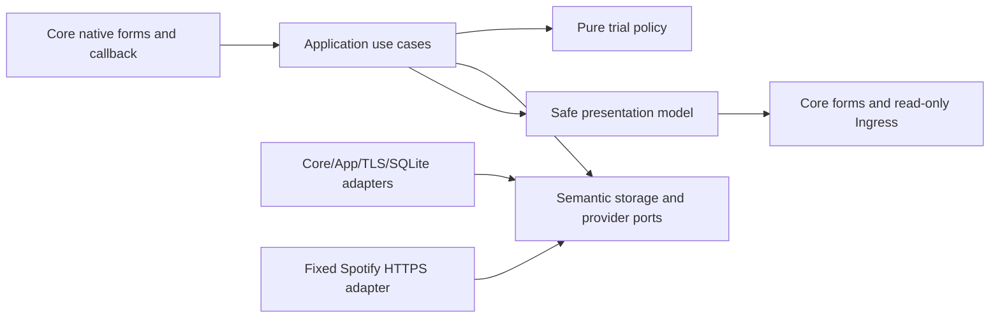

# Native OAuth validation trial

- Status: Ready for implementation
- Date: 2026-10-30
- Catalog capability ID: `native-oauth-validation-trial` (proposed)
- Last verified: 2026-10-30, source/package campaign and Chrome lab pairing/retirement; final presentation reviewed with synthetic states; owner/live acceptance pending.
- Owners: Symphonia maintainers
- Scope: A manually started, installable, twenty-minute Home Assistant trial that validates native Spotify OAuth with an isolated App and auxiliary integration.
- Related issues/PRs: [Issue #32](https://github.com/vypdev/symphonia/issues/32); research #31 and SDK-v1 adoption #34 are reported merged at `develop8045f33`.
- Required review gates: product UX, architecture, testing, documentation, security/operations
- Open decisions blocking readiness: None. The dated engineering review is recorded in `docs/development/native-oauth-trial-preparation.md`; package and live acceptance remain subsequent gates.

The [readiness review](../docs/development/native-oauth-trial-preparation.md) applies the standard's questions under the owner's standing implementation authorization. The bounded implementation is under review. The catalog remains proposed pending owner/live acceptance; see the [dated validation report](../docs/development/native-oauth-trial-acceptance-2026-10-30.md).

## 1. Executive summary

Deliver an isolated, manually started trial for the owner's authorized Home Assistant environment. It uses Core and My with the exact redirect `https://my.home-assistant.io/redirect/oauth`, a dedicated public Spotify PKCE Client ID, and only `user-read-private`. The trial demonstrates native callback staging, a fresh same-administrator confirmation, App-only grant custody, App restart persistence, and one explicitly confirmed forced refresh. It does not establish production readiness.

The Core integration owns the native flow, UI, and safe references. The App alone exchanges authorization codes, validates `/v1/me`, seals provider grants, and refreshes them. Callback receipt only stages a return. The central safety rule is that unknown exchange or refresh outcomes are fenced and never replayed automatically.

```text
Install isolated App and helper -> native pair/start -> Spotify consent in Core/My -> callback stages return -> fresh native admin confirmation -> App exchange and identity check -> restart App -> fresh native refresh confirmation -> compare identity -> retire and clean owned trial state
```

## 2. Problem, current behavior, and evidence

### 2.1 Problem

The owner needs an installable, bounded validation of native Spotify OAuth in the specified HA environment. Existing bounded research and the failed public-callback trial do not prove that an installed native provider connection works. Core's default grant persistence is unsuitable for the desired App-only grant ownership. Broad production OAuth companion, authorization, and runtime specifications remain Draft and are explicitly out of scope.

### 2.2 Current behavior

1. Issue #31 supplied bounded mechanisms research; issue data reports it merged.
2. SDK-v1 adoption #34 is reported merged at `develop8045f33`.
3. The validated owning catalog at commit `8045f33f493a64e008332918e0c1cc671a98d8c6` has no existing owner for this capability.
4. Existing OAuth companion research and a failed public-callback trial do not prove installed native OAuth acceptance.
5. The owner reports HA Core 2026.10.4, Supervisor 2026.10.5, HAOS 18.3, Frontend 20260930.5, Green/aarch64. This is the sole supported trial matrix.

The engineering readiness review was committed before implementation. The current bounded trial passes46 ordinary and8 freshly executed package cases; live owner acceptance remains pending. Broad production readiness is unchanged.

### 2.3 Evidence

- Code/workflow/documentation references: bounded research foundations include `tools/ha_oauth_companion_lab/core_probe.py`, `native_reset_probe.py`, `enrollment_probe.py`, and `key_custody_probe.py`; existing test foundations include `tests/test_ha_oauth_companion_lab.py`, `tests/test_ha_oauth_key_custody_fixture.py`, and `tests/test_ha_oauth_recovery_fixture.py`.
- Incidents or concrete examples: public-callback validation did not establish native installed-provider success; default Core grant persistence does not meet App-only ownership.
- External primary sources: exact official URLs and versioned source snapshots are recorded in section20 and the [hook report](../docs/development/native-oauth-trial-hooks-2026-10-30.md).
- Current native hook feasibility is supported by22 real-Core main-flow/callback observations and the separate36-observation existing research rerun. The My-enabled flag, in-memory App port and four Ingress checks are named fixtures. Those research observations count as zero final-package cases. The current implementation passes all54 source/package cases, actual TLS, App-process restart and Supervisor backup/locked restore; [the report](../docs/development/native-oauth-trial-acceptance-2026-10-30.md) names fixtures and limits. Manual UI and owner My/Spotify acceptance remain pending.

### 2.4 Retrospective classification (as-built baselines only)

Not applicable: this is a prospective specification and does not reconstruct an implemented trial baseline.

## 3. Actors, surfaces, and terminology

| Actor | Goal | Entry point | Visible surfaces |
|---|---|---|---|
| Trial owner / HA administrator | Validate the isolated native OAuth journey and clean it up | Core integration config flow and native forms | Core forms, status, App Ingress read-only status, operations guide |
| Spotify account holder | Grant the fixed read-only profile to the dedicated public client | Core/My authorization journey | Spotify consent page and Core return |
| App operator | Install, inspect, restart, and retire the trial | Supervisor App UI and documented shell installer | App status, Supervisor, logs with safe categories |
| Maintainer | Review readiness, package evidence, and rollback | Pull request and specification review | Issue, PR, checks, package manifests, docs |

**Trial** means the isolated twenty-minute validation capability, not a production integration. **Pairing** establishes a bounded Core-to-App channel. **Staged return** is a validated callback reference awaiting a fresh native confirmation; it is not a grant. **Grant** is the App-owned encrypted provider credential. **Current active administrator** means an administrator identity validated from the current authenticated native Core request. **Owned cleanup** means removing only files and state positively identified as belonging to this trial.

Core is authoritative for native actor context and config-entry safe references. The App is authoritative for trial state, provider grant, and its local keys. Spotify is authoritative for consent, token responses, and account identity. Evidence must distinguish locally observed status from external revocation or provider health.

## 4. Goals, non-goals, and fixed invariants

### 4.1 Goals

1. Provide a reproducible, installable native OAuth validation trial with an original twenty-minute deadline. (SYM-HA-002)
2. Complete native start, callback staging, fresh same-admin confirmation, App-only exchange, restart, and confirmed refresh with the dedicated client. (SYM-HA-012)
3. Keep grant material and private keys out of Core entries, UI, diagnostics, logs, and exports. (SYM-SEC-004)
4. Prove package, security, failure, and cleanup behavior with at least 54 distinct deterministic cases plus separately recorded live acceptance. (SYM-TEST-009)
5. Present actionable, localized status and recovery guidance without claiming unobserved provider outcomes. (SYM-PROV-013)

### 4.2 Non-goals

1. Production OAuth companion, broad authorization/runtime behavior, or changes to their separate Draft budgets.
2. Client Secret, imported/native Spotify credentials, Cloudflare, public App callback, arbitrary provider scopes, write/playback/library/history operations, or migration of production data.
3. Original-browser or login-session continuity claims.
4. Data-preserving production reset or renewal UX; recovery for this disposable trial is retirement and reinstall of its isolated namespace.
5. Treating research hooks or structural SDK validation as installed-package or live acceptance.

### 4.3 Fixed product/safety invariants

| Requirement | Behavior |
|---|---|
| SYM-ACC-006 | Disclose official public-client maturity, scope, dependencies and reauthorization before consent. |
| SYM-HA-002 | Install a distinct Ingress App with working relative routes and owned rollback. |
| SYM-HA-009 | Restrict trial management to current active HA administrators. |
| SYM-HA-012 | Use native config flow and Core/My return with a finite independently authenticated OAuth-only channel. |
| SYM-SEC-002 | Admit only user-read-private, with no optional extra scopes. |
| SYM-SEC-003 | Seal App-owned grants with a separate protected immutable local wrapping key. |
| SYM-SEC-004 | Exclude plaintext grants, codes, verifiers and private keys from all output and Core entry boundaries. |
| SYM-SEC-005 | Fence disconnect and clean owned trial state; observe external revocation separately. |
| SYM-SEC-006 | Bind one-use return to provider, actor, attempt, redirect and original deadline. |
| SYM-SEC-007 | Admit at most one durable refresh owner per grant. |
| SYM-SEC-008 | Disclose read-only bootstrap/status only through verified admin Ingress context. |
| SYM-SEC-010 | Bound hostile values and allow only named internal targets and fixed official provider endpoints. |
| SYM-SEC-011 | Run App as UID 10001 without host ports, broad mounts or Core/Supervisor API authority. |
| SYM-SEC-012 | Require fresh server-validated initiating active-admin confirmation, never callback authority. |
| SYM-SEC-013 | Stage only, durably fence exchange, commit atomically and never replay unknown outcomes. |
| SYM-SEC-014 | Keep grant lifecycle solely in App; never use Core token entry, resolver, session or borrowed credentials. |
| SYM-SEC-015 | Protect install-local keys; disclose encrypted Core backups; exclude App keys and lock missing existing state. |
| SYM-PROV-009 | Map provider errors to fixed safe categories without raw sensitive payloads. |
| SYM-PROV-012 | Run ordinary contracts with deterministic fakes and separately pinned offline package proof. |
| SYM-PROV-013 | Enable live dedicated-client acceptance separately and record teardown and evidence limitations. |
| SYM-TEST-009 | Gate exact App/helper packages, native hooks, Ingress, installer, backups and deadline behavior. |

## 5. Current versus proposed product journey

| Stage | Current | Proposed | User/operator effect |
|---|---|---|---|
| Preparation | Research and structural validation only; no accepted package | Review Ready SDD, build exact source/hash-manifest packages, validate in disposable Core and guarded Supervisor lab | No owner install before package and browser action-time review |
| Install/pair | No proven installable native trial | Install distinct App and helper; pair through bounded pinned channel | Owner sees finite deadline and current status |
| Consent | Public-callback trial did not prove native provider connection | Native Core/My OAuth with exact redirect and fixed scope | Spotify consent occurs in the native flow |
| Return/completion | No established native completion | Callback stages only; fresh authenticated same-admin confirmation admits App exchange | Callback cannot authorize exchange |
| Restart/refresh | No App-only persistence evidence | Restart App, then explicitly confirm one forced native refresh | Same account identity is compared without Core grant storage |
| Teardown | No accepted owned teardown | Retire isolated namespace and remove only owned artifacts | Other apps, integrations, and modified sentinels remain intact |


Text equivalent: install and pair -> native consent -> callback stages -> fresh admin confirms -> App validates and seals -> App restarts -> fresh admin confirms refresh -> compare identity and clean owned state.

## 6. Functional behavior and state model

### 6.1 Happy path

1. The administrator installs the exact App and helper package in the supported matrix and starts the trial manually. Installation requires no Python on the owner's HA host; use the self-contained hash-manifest shell installer and existing POSIX shell, `tar`, `sha256sum`, `base64`, and `/homeassistant` config mount.
2. Core validates the current active administrator and creates a safe-reference config entry. Pairing uses a generated Core CSR and a named App alias derived only from a strictly validated Supervisor slug; fixed TLS port 8098.
3. The App issues a bounded, single-use, five-minute bootstrap. The channel is OAuth-only, pinned private TLS, exact typed envelopes, and bound to installation, pairing, actor, flow, profile, redirect, and deadline.
4. The administrator starts consent in a Core native form. Core/My redirect is exactly `https://my.home-assistant.io/redirect/oauth`. PKCE uses a per-attempt verifier and S256 challenge. Scope is exactly `user-read-private`.
5. Core callback handling validates and stages a bounded return. It never exchanges a code. A fresh native request from the same currently active administrator confirms completion.
6. The App durably claims a consume-once exchange fence before provider I/O, exchanges once against the fixed official HTTPS endpoint, validates `/v1/me` stable `account_id` and scope, seals the grant with a separate protected local key, and atomically publishes safe status. Core entries store no provider grant/code/verifier/private key; the native pairing key has its separate protected-file boundary.
7. After an App restart, the administrator explicitly confirms one forced refresh in a fresh native form. A durable single-flight owner performs it once. If Spotify omits a replacement refresh token, the App may retain the prior verified refresh token. The identity must match the original account.
8. The owner reviews evidence and retires the trial. Cleanup removes only owned trial files and state. Provider-side revocation is observed separately and never claimed from local cleanup alone.

### 6.2 Alternative paths

- User denial, cancellation, or expiration ends the attempt and erases transient authority. No grant is created.
- Bootstrap expiration, callback duplication, stale binding, missing key, unavailable App, or invalid identity fails closed with a safe category and next action.
- App restart does not extend the original 1200-second deadline, rearm bootstrap, or silently provision keys/challenges.
- A missing/corrupt existing App key locks state. Trial recovery is retirement/reinstall of the disposable namespace; it cannot claim recovery of the former grant.
- Unknown exchange or refresh outcome remains uncertain. No automatic replay; require fresh consent or trial retirement as appropriate.
- Provider identity must use bounded stable `account_id`; legacy `id`, name, or email are not fallback identity.

### 6.3 State machine

| State | Entered when | User-visible meaning | Allowed next states | Recovery/owner |
|---|---|---|---|---|
| Uninstalled | No owned package is installed | Trial is not available | Installed, retired | Operator installs reviewed package |
| Installed | Exact package and helper are present | Ready to pair within finite window | Paired, expired, retired | Administrator pairs or retires |
| Paired | Pinned channel and safe references established | Native start is available | Pending, expired, locked, retired | Current administrator starts or retires |
| Pending | Consent attempt and deadline created | Waiting for provider return | Staged, denied, canceled, expired, uncertain | Administrator returns, cancels, or retires |
| Staged | Valid callback return recorded once | Return is awaiting fresh confirmation | Exchanging, canceled, expired | Same active administrator confirms |
| Exchanging | Durable owner claimed before I/O | Provider result is being resolved | Active, failed, uncertain, retired | App commits once or reports safe uncertainty |
| Active | Grant sealed and identity checked | Trial grant is active until original deadline | Refreshing, locked, expired, retired | Administrator requests refresh or retires |
| Refreshing | One durable refresh owner claimed | Confirmed refresh is underway | Verified, uncertain, locked, expired, retired | App commits once or reports uncertainty |
| Verified | Reopened grant refreshed and account matched | Verification complete, retirement still required | Expired, retired | Operator records evidence and retires |
| Failed | Provider response definitively rejected | No accepted grant | Retired | Erase transients and retire |
| Uncertain | Remote operation may have succeeded without local commit | Outcome cannot safely be replayed | Retired; fresh consent only where explicitly safe | Administrator retires/restarts trial per guidance |
| Locked | Required existing key is missing or invalid | Stored grant cannot be opened | Retired | Retire/reinstall disposable namespace |
| Expired/retired | Original deadline elapsed or owner retires | Trial authority ended | Uninstalled | Owned cleanup; no silent renewal |

Duplicate, stale, or out-of-order events cannot replace a staged return or regain consumed authority. Durable exchange/refresh owner and generation fences prevent late owners from publishing after cancellation, unpair, or retirement.

## 7. User-facing configuration

| Input | Type | Recommended default | Allowed values/range | Scope/persistence |
|---|---|---|---|---|
| Spotify public Client ID | Text | Owner-created dedicated client ID | 1–256 printable ASCII characters; reject blank, controls, non-ASCII, and over-limit values; preserve opaque value and encode as one parameter | Trial config snapshot; never logged or echoed |
| Consent profile | Enum | `trial_read_private` | Exactly one fixed profile requesting only `user-read-private` | Immutable for each attempt and grant |
| Redirect profile | Enum | `my_home_assistant` | Exactly `https://my.home-assistant.io/redirect/oauth` | Immutable for each attempt |
| App target | Validated Supervisor slug | Actual installed slug, beginning with local_ or its eight-hex repository prefix | Bare slug is not a target; derive only named internal hyphen alias and TLS port 8098 | Pairing snapshot; no arbitrary host, URL, path, or port |
| Trial duration | Integer seconds | 1200 seconds | Fixed; not configurable | Original persisted deadline survives restart unchanged |
| Bootstrap duration | Integer seconds | 300 seconds | Fixed, single-use | Consumed/expired state cannot be rearmed |

Recommended configuration is the dedicated public client, fixed read profile, My redirect, named App slug, and the twenty-minute deadline. The only meaningful alternative is the exact validated local versus eight-hex repository-prefix slug form when the Supervisor installation uses that naming form; both resolve to the same named App. No arbitrary endpoint, scope, redirect, TLS port, deadline, credential, key regeneration, or operation is configurable. Missing, retired, or unknown persisted values fail closed; there is no migration from provider credentials in Core entries.

## 8. Clean Architecture design

### 8.1 Responsibilities and dependency direction

| Layer/boundary | Owns | Must not own/import |
|---|---|---|
| Domain/pure policy | Slug, bounds, scope, deadline, binding, state transition, and safe-category rules | HA SDK, HTTP clients, provider DTOs, filesystem |
| Application | Pair/start/stage/confirm/exchange/refresh/retire use cases and immutable contracts | Concrete HA SDK, Supervisor process APIs, provider HTTP implementation |
| Adapters/data | Core native auth adapter, callback adapter, App TLS/API adapter, Spotify adapter, durable store and key adapter | Product policy or arbitrary endpoint selection |
| Infrastructure/composition | HA/App process wiring, SQLite, protected files, TLS and fixed provider transport | Business decisions or caller-provided hosts |
| Entrypoints | Native forms, Core callback, App read-only Ingress and service startup | Duplicated orchestration or trusting callback as actor |
| Presentation | Localized status view models and escaped rendering | Mutations, grant state transitions, raw provider payloads |



### 8.2 Contracts, state, and trust boundaries

- Pure decisions: typed envelope validation, strict target derivation, fixed scope/redirect, deadline and binding equality, state transitions, safe error categories.
- Application contracts: immutable pair, attempt, staged return, fresh confirmation, status, exchange, refresh, and retirement requests/results; no secret-bearing response crosses into presentation.
- Semantic ports: authenticated actor lookup, durable consume-once claim, atomic grant commit, sealed-grant repository, key custody, pinned channel, fixed provider exchange/refresh/profile lookup, clock, and safe status publication.
- Durable state/schema ownership: App owns attempt state, fences, sealed grant, status, and its local key files. Core owns only safe config/reference fields and its private pairing key outside the config entry. App private keys are excluded from backups; Core backup disclosure follows the owner-selected encrypted-Core-backup trust model.
- Concurrency/idempotency strategy: transactionally claim one exchange/refresh owner before I/O; commit ciphertext and active reference atomically; persist uncertain outcomes; generation fence prevents late publication; lost acknowledgement returns safe status without replay.
- Trusted and untrusted inputs: only current server-validated native request establishes actor; callback values, Ingress headers, browser fields, provider payloads, persisted files, and repository/user text are untrusted until bounded and validated.
- Provider error mapping: fixed categories such as denied, invalid grant, unavailable, malformed response, deadline, and uncertain. Never expose raw body, URL, header, exception, code, token, or verifier.

The App's attempt verifier and staged code remain volatile; no database, Core entry or log persists them. A restart cancels an unadmitted transient attempt. An admitted incomplete exchange/refresh becomes uncertain, and health/status cannot finish or replay it. This disposable version permits one consent attempt and one forced refresh per installation; denial, cancellation or definitive failure requires retirement and a fresh explicit trial namespace, without extending the old deadline.

The original UTC deadline and a nondecreasing observed clock bound survive restart. Clock rollback or invalid persisted metadata locks. Service lifetime, certificates and bootstrap cannot outlive the original deadline. Native start constructs a separate public PKCE authorizer per attempt, transfers its verifier over the paired channel and drops redundant Core references after caching the authorize URL; memory zeroization is not promised. Staging must originate through the real Core callback HTTP route and validated exact state, not just a submitted flow identifier or state-shaped object. Confirmation additionally requires a new native POST to the current flow by the initiating active administrator.

The safe original consent binding remains immutable after activation. A later refresh carries that original binding plus a separate confirmation_flow identifying the NEW native reconfigure flow. Core validates current HTTP actor and that current flow before sending; App binds the refresh fence to the new flow and original grant/install/pair/actor/profile/deadline. It must not relabel the original consent flow as the fresh confirmation or infer continuity from a saved flow ID.

Grant ciphertext, account binding, generation and active reference commit in one SQLite transaction under the admitted owner/epoch. Wrapping key is immutable, separately referenced and excluded from backups; authenticated data also binds credential generation. No multi-file secret publication or key rotation is part of this trial. All Core/App private files follow ADR0008: owned0700 directories, regular single-link0600 files, bounded no-follow reads, explicit first-provision marker and no rekey on partial or invalid existing state. Core restore requires operator revocation of the old App pair and explicit re-pairing; clone detection is not promised.

### 8.3 Executable architecture constraints

Automated checks MUST verify dependency direction and import boundaries, forbid Core token resolver/token-entry/OAuth2Session paths, parse exact route and provider endpoint allowlists, validate typed envelope schemas and state schema, inspect package file manifests and hash/ownership rules, assert no App host ports/broad mounts/API privileges, and scan output/diagnostic fixtures for secret canaries. Package checks MUST exercise the actual helper and App artifacts. The live proof is distinct from deterministic contract tests.

## 9. UI/UX and content contract

### 9.1 Information hierarchy

Core and App status show current state, completed facts, next transition, required human action, impact/retained state, and safe inspectable details in that order. Core native forms own every mutating consent/refresh action. App Ingress is read-only bootstrap/status and contains no form POST or HA browser credential reads. Any temporary semantic text-only diagnostic presentation must be explicitly documented and reviewed.

### 9.2 Representative primary view

```markdown
# Spotify trial: waiting for confirmation

> **Current status:** Spotify returned to Home Assistant. The return is staged; no code has been exchanged.
>
> **Action required:** In the native Home Assistant form, confirm as the same active administrator before the 20-minute deadline.

## Progress

- [x] Trial paired with the named App
- [x] Consent return validated and staged
- [ ] Fresh administrator confirmation

## What happens next

After confirmation, the App exchanges once and checks the Spotify account. If the result is uncertain, it will not retry the code.

## Important

This public-client trial requests only `user-read-private`. It is an early validation and may require new consent. App keys are excluded from backups; Core backup trust follows the configured encrypted-backup model.
```

Concrete state variants:

**Pending / no action yet** — “Current status: Waiting for Spotify return. Completed: trial is paired and consent was opened. Next: finish consent or cancel in the native flow. Action required: finish before the displayed deadline. No grant exists yet.”

**Action required** — “Current status: Return staged. Completed: callback was validated; no exchange occurred. Next: confirm in a fresh native form. Action required: the same current active administrator must confirm before expiry.”

**Blocked before irreversible effect** — “Current status: Pairing could not be verified. Completed: no provider request or grant was made. Cause: the pinned App identity did not match. Action: inspect the named App and retry pairing or retire the trial. Retained state: safe config reference only.”

**Partial/uncertain after possible provider effect** — “Current status: Spotify may have processed the exchange, but local completion was not confirmed. Completed: the attempt was durably fenced. Next: retire this trial and start a new consent attempt only as directed. Action required: do not retry this code. Retained state: uncertain marker; no grant is reported active.”

**Completed** — “Current status: Account check and confirmed refresh succeeded. Completed: the App reopened its sealed grant after restart and refreshed once; account identity matched. Next: review evidence and retire the trial. Action required: retire the trial and revoke dedicated provider access separately. Retained state: App-local encrypted grant until retirement.”

### 9.3 Issue, PR, and comment behavior

- Deterministic PR title: `Add isolated native OAuth validation trial`; purpose is the proposed SDD and, after Ready, exact implementation/package evidence.
- Merge/close/retry cannot silently install, consent, extend the deadline, replay a provider operation, or broaden permissions. Re-running deterministic offline checks is safe; live actions require explicit operator action.
- Issue #32 remains the canonical work record. PR/check summaries link to the issue, SDD, exact package manifest, acceptance record, and cleanup instructions. No invented repository placeholders.
- Update the durable issue/PR summary idempotently; do not create repetitive status comments. Comment/notification budget: at most one initial progress comment and one final evidence comment for this trial lifecycle; use edited summary/checks for subsequent status.
- Labels and checks supplement, never replace, written status. Titles/headings are stable and descriptive. Links contain no secrets, private hostname, callback code, or token.

### 9.4 Accessibility, localization, and responsive behavior

Core translations support English and Spanish with HA locale fallback. Use native form controls, keyboard navigation, labeled actions, announced pending/success/failure states, textual equivalents for diagrams, semantic headings, descriptive links, and narrow viewport layouts. Never rely on color or icon alone. Escape hostile provider and user text; reject unsafe URLs and Markdown/HTML/mentions/commands in generated evidence. App Ingress presents read-only, bounded status and bootstrap guidance only.

## 10. Failure, recovery, and cleanup

| Failure/partial state | User impact | Retained facts | Automatic retry | Required action | Cleanup |
|---|---|---|---|---|---|
| Invalid Client ID/slug/envelope | No attempt or request admitted | Safe validation category | No | Correct bounded input | No partial state |
| Pairing TLS pin/CSR failure | No bootstrap or sensitive body sent | Safe pairing status | No implicit retry | Inspect exact App and retry pairing explicitly | Remove only owned partial pairing state |
| Denial/cancel/expiry | No grant | Terminal attempt category and original deadline | No | Retire; explicitly install a fresh disposable trial if desired | Erase transient code/verifier authority |
| Duplicate/stale callback | No state replacement | Existing staged/terminal state | No | Continue existing flow or start new consent | No added authority |
| Exchange uncertain | Grant activation unknown | Durable uncertain fence | Never | Retire trial; do not replay code | Remove owned local trial state on retirement |
| Provider error/invalid scope/identity | No accepted grant | Fixed category; no raw payload | No for unknown or invalid grant | Correct setup, retire and use a fresh explicit trial | Erase transient authority |
| Refresh uncertain/invalid grant | Existing grant may be unusable | Uncertain fence or invalid-grant category | Never | Retire; new consent only through a fresh explicit trial | Fence old refresh credential |
| App key missing/corrupt | Sealed grant cannot be opened | Locked marker and sealed evidence | No key regeneration | Retire/reinstall disposable namespace | Exclude keys from backups; remove only owned state |
| App restart/deadline elapsed | Trial authority remains bounded or expires | Original deadline persists | No extension | Explicitly confirm refresh only while valid | Stop listeners and retire after expiry |
| Installer conflict/unowned sentinel | Installation/rollback stops | Hash and ownership evidence | No overwrite | Review conflict manually | Preserve unrelated/modified files |
| Local cleanup succeeds, provider revocation unknown | Local trial is removed; Spotify grant revocation is unobserved | Cleanup manifest | No claim of remote revocation | Separately revoke dedicated access at Spotify and record its actual outcome | Record any unobserved step |

Errors follow `impact -> cause -> action -> retained state`. A provider operation that may have succeeded is never described as failed without qualification.

## 11. Security, permissions, and privacy

1. Mutating native operations require a fresh server-validated current active administrator. Callback, flow ID, browser fields, App Ingress, and background context cannot supply authority.
2. App is a distinct Ingress App running UID 10001, with no host ports, broad mounts, Core API privilege, or Supervisor API privilege. Only the strictly validated named App alias and fixed TLS port 8098 are reachable.
3. Pairing uses generated Core CSR, private TLS pinning, bounded single-use five-minute bootstrap, exact typed envelopes, and binding to installation, App, actor, pairing generation, attempt, flow, profile, redirect, and original deadline. Validate server pin before sending sensitive body. No arbitrary URL/host, redirects, proxy environment, or endpoint overrides.
4. Spotify transport uses only exact official HTTPS token/profile endpoints, normal CA validation, a real total ten-second deadline capped by remaining trial lifetime and at most64KiB response body, no redirects or proxy environment. Cancellation ends outstanding DNS/provider work rather than abandoning a thread. Responses reject duplicate JSON fields and invalid types. Scope is only `user-read-private`; no shipping endpoint/fake-provider override exists. Offline ProviderPort injection belongs only to lab composition.
5. Authorization code, verifier, access/refresh grant, and App private keys never enter Core entry, UI, logs, diagnostics, exports, or public evidence. Core stores safe references and a protected mode-0600 private pairing key outside the entry. App keys are protected install-local files and excluded from backups. Missing existing key locks without replacement.
6. App encrypts grants with authenticated encryption and a separate immutable local wrapping key; bind ciphertext to installation, profile, client, and pairing generation. SQLite transaction commits grant and active reference atomically.
7. Durable consume-once fences precede exchange/refresh I/O. Unknown outcomes are not replayed. Single-flight refresh and generation fences prevent concurrent rotation or late publication.
8. Ingress is read-only and available only with verified admin context. No browser credential reads, App mutating form posts, or public App OAuth callback.
9. Owner-selected trust model assumes encrypted Core backups protect Core pairing material; App grant keys remain excluded. Disclose that restoring without App keys locks the trial.
10. Live evidence excludes codes, tokens, cookies, private HA hostname, and identifiable account data. Compare identity locally or by protected hash and publish only the minimum outcome.

## 12. Observability and operational UX

- User-facing state: bounded state, observed-at time, original deadline, next action, and fixed safe reason category. Polling is bounded and cannot imply live health.
- Operator evidence: exact package source/hash manifest, environment matrix, install/rollback ownership, deterministic case results, package test record, and redacted live acceptance record.
- Logs/metrics/correlation: opaque attempt and installation references only; no provider payloads, credentials, URL query, headers, callback values, CSR private material, or raw exception. Correlation identifiers are non-secret and bounded.
- External dependency versus workflow failure: distinguish Spotify unavailable, local deadline, TLS identity mismatch, and uncertain remote outcome. Never claim external revocation or provider health from local status.
- Rate-limit/retry: no automatic retry for code exchange, refresh, or unknown outcome. Read-only status polling has a fixed bounded interval and request limit.
- Noise budget: no recurring comments, notifications, or unbounded logs; one durable status surface and the issue/PR comment budget in section 9.3.

## 13. Compatibility, migration, rollout, and rollback

- Existing in-flight operations/data: none; this is a new isolated capability. Do not inspect, migrate, or borrow production/native Spotify entries.
- Schema/configuration migration: no grant migration. Unknown or retired schema fails closed and requires retirement/reinstall. Preserve original deadline and fences across restart.
- Deprecated behavior: public callback, Core grant persistence, broader scopes, arbitrary endpoints, and silent key regeneration are prohibited for this trial.
- Rollout: SDD review to Ready; implement and package; exact disposable Core 2026.10.4 and guarded Supervisor lab validation with fake provider; review package; obtain applicable action-time browser approval; only then owner installation/Core restart and live consent. The owner's explicitly authorized direction covers implementation after Ready; owner installation still follows the described reviewed package and action-time approval gate.
- Rollback: hash-manifest installer stages and removes only allowlisted, hash-matching owned files. Conflicts or modified/unowned sentinels stop rollback without overwrite. Retire App namespace and integration state; leave other apps/integrations intact. External Spotify revocation is separate.

## 14. Testing strategy and numeric budget

The floor is 54 distinct deterministic trial cases: 12 pure/configuration, 12 state/replay/concurrency, 12 provider/TLS/secret adapters, 10 native HTTP/UI/sanitization, and 8 integration/package/restart/security. All pass in the isolated campaign; see the dated report for boundaries. Live dedicated-client and owner-browser checks supplement, and do not count toward, this floor. Existing research rerun evidence of 36 observations with Ingress stubbed is research only and counts as zero final-package cases.

| Area | Minimum distinct cases | Behaviors/risks covered |
|---|---:|---|
| Pure/configuration | 12 | Observable scenarios in the case inventory. |
| State/application | 12 | Observable scenarios in the case inventory. |
| Provider/TLS/secret adapters | 12 | Observable scenarios in the case inventory. |
| Native HTTP/UI/sanitization | 10 | Observable scenarios in the case inventory. |
| Integration/package/restart/security | 8 | Observable scenarios in the case inventory. |
| Total | 54 | Distinct inventory cases; repeated executions do not add cases. |

| Case ID | Area | Requirements | Scenario |
|---|---|---|---|
| native-trial-pure-C01 | Pure/configuration | SYM-SEC-010 | Opaque public Client ID: accept bounded printable ASCII containing URL-significant characters and length different from 32; preserve exact value as one encoded parameter without inventing a hex rule. |
| native-trial-pure-C02 | Pure/configuration | SYM-SEC-010 | Client ID bounds: blank, control, non-ASCII, or over-256-character input is rejected before attempt creation and is not echoed. |
| native-trial-pure-C03 | Pure/configuration | SYM-SEC-010 | Named App target: exact local or eight-hex repository prefix plus `symphonia_native_oauth_trial` derives only its internal hyphen alias and fixed TLS port 8098. |
| native-trial-pure-C04 | Pure/configuration | SYM-SEC-010 | Target injection: URL, path, alternate port, IP literal, or lookalike suffix is refused and causes no arbitrary outbound request. |
| native-trial-pure-C05 | Pure/configuration | SYM-SEC-006, SYM-HA-012 | Exact My redirect: accept only `https://my.home-assistant.io/redirect/oauth`; reject changed scheme, host, path, slash, or query. |
| native-trial-pure-C06 | Pure/configuration | SYM-SEC-002 | Fixed read profile: admit only `user-read-private`; reject added email, library, playback, or write scopes. |
| native-trial-pure-C07 | Pure/configuration | SYM-SEC-006 | Bootstrap expiry: at the five-minute boundary, expired or consumed bootstrap is unusable and restart cannot rearm it. |
| native-trial-pure-C08 | Pure/configuration | SYM-SEC-006 | Original deadline: reload after restart, expiry, or backwards clock movement; retain original 1200-second deadline and fail closed on invalid/rollback state. |
| native-trial-pure-C09 | Pure/configuration | SYM-SEC-010 | Envelope bounds: reject boolean epochs, unsupported versions, extra fields, and oversized identifiers before policy transition. |
| native-trial-pure-C10 | Pure/configuration | SYM-SEC-015 | Private-file identity: wrong owner/mode, symlink, extra hardlink, non-regular file, or excessive size refuses unsafe existing state without replacement. |
| native-trial-pure-C11 | Pure/configuration | SYM-HA-012, SYM-SEC-011 | OAuth operation allowlist: reject playback, general Core, arbitrary HTTP, and renewal operations outside finite OAuth-only protocol. |
| native-trial-pure-C12 | Pure/configuration | SYM-SEC-006, SYM-SEC-012 | Immutable binding: altered installation, actor, pairing/credential generation, flow, profile, or redirect fails canonical comparison; client fields cannot substitute trusted context. |
| native-trial-state-C01 | State/application | SYM-SEC-013 | Stage without exchange: valid callback before native confirmation changes staged state only; provider exchange count remains zero. |
| native-trial-state-C02 | State/application | SYM-SEC-006, SYM-SEC-005 | Provider denial: bounded denial makes attempt terminal and erases transient authority without creating a grant. |
| native-trial-state-C03 | State/application | SYM-SEC-005, SYM-SEC-006 | Cancellation and expiry: cancel/expire pending or staged attempt, then deliver late return/confirmation; terminal state wins, with no exchange or reconstructed verifier/code. |
| native-trial-state-C04 | State/application | SYM-SEC-006 | Duplicate/stale callback: duplicate, different code, or stale attempt cannot replace immutable staged return or admit a second return. |
| native-trial-state-C05 | State/application | SYM-SEC-012 | Fresh same-admin completion: absent actor, changed actor, and stale pairing are rejected; valid fresh initiating-admin confirmation admits only exact current binding. |
| native-trial-state-C06 | State/application | SYM-SEC-013 | Concurrent exchange admission: race two completions; one durable owner is admitted before provider I/O and at most one exchange occurs. |
| native-trial-state-C07 | State/application | SYM-SEC-013 | Lost completion acknowledgement: commit result, lose reply, then request status and repeat completion; return same safe result without another exchange. |
| native-trial-state-C08 | State/application | SYM-SEC-013 | Unknown exchange result: interrupt after possible send before commit; persist uncertain state and never repeat code on restart/status. |
| native-trial-state-C09 | State/application | SYM-SEC-003, SYM-SEC-013 | Atomic grant activation: fail SQLite transaction between ciphertext and active-reference writes; observe all-old or all-new, never active reference to unpublished/foreign grant. |
| native-trial-state-C10 | State/application | SYM-SEC-007 | Single-flight refresh: race two fresh native refreshes for one grant; admit one refresh owner and prevent parallel destructive rotation. |
| native-trial-state-C11 | State/application | SYM-SEC-007, SYM-SEC-013 | Unknown refresh result: interrupt after possible token rotation before commit; remain uncertain and do not reuse possibly invalid old token. |
| native-trial-state-C12 | State/application | SYM-SEC-005, SYM-SEC-013 | Late owner after unpair: unpair/expire while owner awaits provider; stale owner cannot activate or publish after generation fence. |
| native-trial-adapter-C01 | Provider/TLS/secret adapters | SYM-HA-012, SYM-SEC-014 | Per-attempt PKCE: two attempts have distinct verifiers/challenges, S256, exact redirect/client/profile; clear redundant Core references after caching URL. |
| native-trial-adapter-C02 | Provider/TLS/secret adapters | SYM-SEC-006, SYM-SEC-004 | Callback bounds: missing/both code-and-error, extra state, oversized return, or binding mismatch is not staged and raw input is not logged. |
| native-trial-adapter-C03 | Provider/TLS/secret adapters | SYM-SEC-015, SYM-SEC-010 | Pin before sensitive body: wrong SPKI or TLS identity causes no bootstrap, verifier, code, or approval body to be sent. |
| native-trial-adapter-C04 | Provider/TLS/secret adapters | SYM-SEC-012, SYM-SEC-015 | CSR/certificate binding: altered key, installation, epoch, purpose, or issued certificate is refused; no finite-trial renewal endpoint exists. |
| native-trial-adapter-C05 | Provider/TLS/secret adapters | SYM-PROV-009, SYM-SEC-010 | Strict response decoding: duplicate JSON keys, unexpected types, invalid UTF-8, and oversized provider payloads map to fixed categories without body disclosure. |
| native-trial-adapter-C06 | Provider/TLS/secret adapters | SYM-SEC-002 | Verified exchange scope: exact scope is accepted only when explicitly verified; missing unprovable or expanded scope cannot activate. |
| native-trial-adapter-C07 | Provider/TLS/secret adapters | SYM-SEC-014 | Stable account identity: use bounded `account_id`; absent/malformed value is unsupported even when legacy id/name/email exist. |
| native-trial-adapter-C08 | Provider/TLS/secret adapters | SYM-SEC-007, SYM-SEC-014 | Refresh replacement omission: new access token without replacement refresh token/scope retains prior verified refresh token/profile and publishes atomically. |
| native-trial-adapter-C09 | Provider/TLS/secret adapters | SYM-PROV-009 | Refresh invalid grant: fixed category requires fresh consent and does not retry old grant automatically. |
| native-trial-adapter-C10 | Provider/TLS/secret adapters | SYM-SEC-010, SYM-PROV-012 | Bounded fixed provider transport: redirect, proxy environment, TLS failure, trickled/oversized response, stalled DNS/request use fixed targets, no redirects/proxies, real total deadline, and cancellation leaves no request running. |
| native-trial-adapter-C11 | Provider/TLS/secret adapters | SYM-SEC-003, SYM-SEC-015 | AEAD binding integrity: changed AAD, ciphertext, nonce, key, installation/profile/client/pair generation fails authenticated open; no plaintext fallback. |
| native-trial-adapter-C12 | Provider/TLS/secret adapters | SYM-SEC-015 | Missing/wrong wrapping key: existing grant locks without generating key, deleting sealed evidence, or claiming recovery. |
| native-trial-http-C01 | Native HTTP/UI/sanitization | SYM-HA-009, SYM-SEC-012 | Unauthenticated native action: pair/start/complete/refresh without current validated native request admits no mutation; flow ID/callback is insufficient. |
| native-trial-http-C02 | Native HTTP/UI/sanitization | SYM-HA-009, SYM-SEC-012 | Non-admin native action: explicit ordinary-user fixture is refused even if headers or fields claim administrator status. |
| native-trial-http-C03 | Native HTTP/UI/sanitization | SYM-SEC-012 | Actor source and confirmation: forged fields, callback context, or background context cannot supply actor; only fresh authenticated native request actor confirms. |
| native-trial-http-C04 | Native HTTP/UI/sanitization | SYM-HA-002, SYM-HA-012 | Read-only App surfaces: probe GET/POST and callback-like paths; Ingress only renders bounded bootstrap/status and App has no mutating browser form/public OAuth callback. |
| native-trial-http-C05 | Native HTTP/UI/sanitization | SYM-SEC-004, SYM-SEC-014 | Entry/saved-file allowlist: synthetic token/code/verifier/private-key canaries in harness never leak; only safe references/config persist. |
| native-trial-http-C06 | Native HTTP/UI/sanitization | SYM-SEC-014 | Core token-path trap: failing token resolver, token-entry creation, and OAuth2Session are never invoked; custom staged completion borrows no native credential. |
| native-trial-http-C07 | Native HTTP/UI/sanitization | SYM-SEC-008, SYM-HA-009 | Ingress trust boundary: wrong peer/base/session/admin context and direct-listener request disclose no private bootstrap/status. |
| native-trial-http-C08 | Native HTTP/UI/sanitization | SYM-SEC-004, SYM-PROV-009 | Hostile text sanitization: provider names/errors and secret canaries in all render paths are escaped; fixed reasons only, no raw URL/header/exception/body. |
| native-trial-http-C09 | Native HTTP/UI/sanitization | SYM-ACC-006, SYM-SEC-002 | Native usability/disclosure: English/Spanish keyboard and narrow viewport journey announces states and exposes scope, maturity, key, backup, and next-action disclosures. |
| native-trial-http-C10 | Native HTTP/UI/sanitization | SYM-HA-002, SYM-PROV-013 | Truthful status/polling: unavailable/stale/expired/uncertain reads remain bounded and observed-at; no false health, recovery, or revocation claim. |
| native-trial-package-C01 | Integration/package/restart/security | SYM-SEC-012, SYM-TEST-009 | Real Core 2026.10.4 actor hooks: exact helper in disposable Core exercises authenticated HTTP and disabled/revoked synthetic actors; no owner user is modified. |
| native-trial-package-C02 | Integration/package/restart/security | SYM-HA-012, SYM-SEC-013 | Main-flow callback routing: packaged reconfigure flow and Core-signed state deliver simulated return through real callback HTTP; it stages only and requires fresh native confirmation; not live My/Spotify proof. |
| native-trial-package-C03 | Integration/package/restart/security | SYM-SEC-015, SYM-SEC-011, SYM-TEST-009 | Actual package CSR/mTLS: exact artifacts in guarded disposable Supervisor topology prove alias, pin, CSR, client certificate, refusal of invalid identities/operations, and no host exposure. |
| native-trial-package-C04 | Integration/package/restart/security | SYM-PROV-012, SYM-SEC-014 | Offline full consent composition: same package source with test-only injected ProviderPort, isolated egress, and actual native/TLS paths completes one exchange/account check/sealed grant; shipping artifact has no fake endpoint config. |
| native-trial-package-C05 | Integration/package/restart/security | SYM-SEC-003, SYM-SEC-007, SYM-SEC-014 | Real App restart/refresh: restart after committed sealed grant, freshly confirm one forced refresh, reopen same grant/deadline and compare account hashes; no Core token or extra consent. |
| native-trial-package-C06 | Integration/package/restart/security | SYM-SEC-015, SYM-TEST-009 | App-only backup/locked restore: real isolated App backup excludes CA/server/wrapping keys and plaintext grant; restore stays locked without key/challenge regeneration. |
| native-trial-package-C07 | Integration/package/restart/security | SYM-TEST-009, SYM-SEC-010 | Owned installer/rollback: stage/install/remove allowlisted files; existing/modified/unowned sentinels stop overwrite, preserve unrelated files, and do not widen Terminal permissions. |
| native-trial-package-C08 | Integration/package/restart/security | SYM-SEC-005, SYM-SEC-006, SYM-PROV-013 | Deadline/retirement after restart: restart before/after deadline does not extend authority or rebootstrap; listeners stop at expiry and cleanup preserves other apps/integrations. |

Define coverage and execution gates: preserve repository-wide thresholds; changed modules meet or exceed repository thresholds; new pure policy has at least 90% branch coverage. Use deterministic clock/IDs/fakes, no real waits/live services in ordinary tests, explicit race/replay/adapter/security fixtures, semantic UI assertions beyond snapshots, and package structural parsing rather than prose grep. The exact packaged helper/App must pass offline lab cases before owner installation. Manual UX review records keyboard operation, narrow viewport, language, disclosures, and truthful status. Live provider/browser acceptance is separately approved and redacted.

## 15. Documentation and discoverability

| Audience | Artifact/page | Required content | Validation/navigation |
|---|---|---|---|
| User | `symphonia_native_oauth_trial/README.md` | Normal journey, maturity/scope, consent, deadline, restart and retirement | Package README link and fixture review |
| Setup owner | `docs/operations/native-oauth-trial.md` | Prerequisites, exact HA matrix, dedicated client setup, permissions, installation, backup trust and cleanup | Shell/package contract and reviewed checklist |
| Operator | `docs/operations/native-oauth-trial.md` | State meanings, uncertainty, locked key, troubleshooting, retirement, external revocation limitation | Decision-tree review against failure table |
| Contributor | `docs/development/native-oauth-trial-test-plan.md` | Ports, architecture, deterministic tests, package and live evidence separation | Architecture checks and test-plan review |
| Maintainer | `docs/development/native-oauth-trial-hooks-2026-10-30.md`, `docs/development/native-oauth-trial-preparation.md`, `docs/development/native-oauth-trial-acceptance-2026-10-30.md` | Hook research, preparation boundaries, dated acceptance evidence | Exact artifact/hash and evidence review |

| Path | Change |
|---|---|
| `specs/native-oauth-validation-trial.md` | create |
| `symphonia_native_oauth_trial/config.yaml` | create |
| `symphonia_native_oauth_trial/Dockerfile` | create |
| `symphonia_native_oauth_trial/requirements.txt` | create |
| `symphonia_native_oauth_trial/SHA256SUMS` | create |
| `pyproject.toml` | update |
| `symphonia_native_oauth_trial/README.md` | create |
| `symphonia_native_oauth_trial/run.py` | create |
| `symphonia_native_oauth_trial/policy.py` | create |
| `symphonia_native_oauth_trial/application.py` | create |
| `symphonia_native_oauth_trial/keys.py` | create |
| `symphonia_native_oauth_trial/store.py` | create |
| `symphonia_native_oauth_trial/provider.py` | create |
| `symphonia_native_oauth_trial/tls.py` | create |
| `symphonia_native_oauth_trial/server.py` | create |
| `custom_components/symphonia_native_oauth_trial/__init__.py` | create |
| `custom_components/symphonia_native_oauth_trial/manifest.json` | create |
| `custom_components/symphonia_native_oauth_trial/config_flow.py` | create |
| `custom_components/symphonia_native_oauth_trial/bridge.py` | create |
| `custom_components/symphonia_native_oauth_trial/keys.py` | create |
| `custom_components/symphonia_native_oauth_trial/strings.json` | create |
| `custom_components/symphonia_native_oauth_trial/translations/en.json` | create |
| `custom_components/symphonia_native_oauth_trial/translations/es.json` | create |
| `tools/stage_native_oauth_trial.py` | create |
| `tools/native_oauth_trial_lab.py` | create |
| `tools/install_native_oauth_trial_helper.sh` | create |
| `tests/test_native_oauth_trial_policy.py` | create |
| `tests/test_native_oauth_trial_state.py` | create |
| `tests/test_native_oauth_trial_adapters.py` | create |
| `tests/test_native_oauth_trial_ha_adapter.py` | create |
| `tests/test_native_oauth_trial_packaging.py` | create |
| `docs/operations/native-oauth-trial.md` | create |
| `docs/development/native-oauth-trial-test-plan.md` | create |
| `docs/development/native-oauth-trial-hooks-2026-10-30.md` | create |
| `docs/development/native-oauth-trial-preparation.md` | create |
| `docs/development/native-oauth-trial-acceptance-2026-10-30.md` | create |
| `specs/README.md` | reference |
| `specs/_template.md` | reference |
| `specs/home-assistant-oauth-companion.md` | reference |
| `specs/provider-connections-and-authorization.md` | reference |
| `specs/home-assistant-app-runtime-and-ingress.md` | reference |
| `specs/home-assistant-native-ui.md` | reference |
| `docs/decisions/0007-home-assistant-oauth-companion.md` | reference |
| `docs/decisions/0008-install-local-oauth-keys-and-backups.md` | reference |
| `docs/architecture/home-assistant-oauth-companion-rfc.md` | reference |
| `docs/architecture/local-key-custody-rfc.md` | reference |
| `docs/development/oauth-recovery-and-pairing-lab-2026-10-25.md` | reference |
| `docs/development/ha-oauth-companion-lab-2026-10-25.md` | reference |
| `docs/providers/provider-research.md` | update |
| `docs/providers/home-assistant-ecosystem-review.md` | reference |
| `tools/ha_oauth_companion_lab/README.md` | reference |
| `tools/ha_oauth_companion_lab/core_probe.py` | reference |
| `tools/ha_oauth_companion_lab/native_flow_probe.py` | create |
| `tools/ha_oauth_companion_lab/native_reset_probe.py` | reference |
| `tools/ha_oauth_companion_lab/enrollment_probe.py` | reference |
| `tools/ha_oauth_companion_lab/app/server.py` | reference |
| `tests/test_ha_oauth_companion_lab.py` | reference |
| `tests/test_ha_oauth_key_custody_fixture.py` | reference |
| `.github/workflows/verify.yml` | update |
| `tools/ha_oauth_companion_lab/key_custody_probe.py` | reference |
| `tests/test_ha_oauth_recovery_fixture.py` | reference |
| `docs/operations/home-assistant-oauth.md` | update |
| `specs/catalog.json` | update |
| `specs/CATALOG.md` | update |
| `docs/development/ha-app-lab.md` | update |

New user/setup/operator documentation MUST be linked from the App README and repository navigation appropriate to the existing conventions. Examples and command snippets must be validated against implementation fixtures. Catalog metadata retains proposed status and distinguishes implementation/laboratory evidence from research and pending manual/live acceptance. The Action remains sole publisher and branch owner.

The native Reconfigure menu includes an explicit Retire trial confirmation. A current active administrator may revoke the local pair/grant; Core then removes only hash-matching private files and records any cleanup still pending. Normal entry removal accepts that receipt. Lost revocation acknowledgement preserves keys and reports uncertainty; stop the App. The installer verifies source and recorded runtime-cache hashes before removal, preserving unexpected files. Failed enrollment without an entry may leave protected partial Core material for explicit owned reconciliation; never claim automatic removal.

Installer cache receipts require a valid ownership header and unique allowlisted paths before any removal. Package case native-trial-package-C07 verifies duplicate and empty receipts preserve all source/cache bytes.

Read-only status distinguishes persisted retirement from deadline expiry, including after restart. Clock rollback still reports locked; retirement never reopens grant authority. Cases native-trial-state-C12, native-trial-http-C10 and native-trial-package-C08 verify these outcomes.

The fixed HTTPS adapter explicitly requests identity encoding and refuses compressed or redirected responses, preserving its byte cap; case native-trial-adapter-C10 verifies negotiation. App-store README links use immutable absolute documentation URLs because Supervisor does not resolve repository-relative links.

Every decoded protocol, bootstrap and provider JSON object is bounded to32 nested containers, including the root. Depth is checked independently of Python runtime recursion behavior; excess depth and non-finite JSON numbers fail closed before typed admission. Case native-trial-http-C05 and native-trial-adapter-C05 cover this bound across supported runtimes.

## 16. Acceptance scenarios

1. Given the exact supported disposable Core/Supervisor matrix and reviewed package, when the owner installs and pairs, then the distinct App/helper work through relative Ingress routes and owned rollback without host ports or broad privilege.
2. Given a configured dedicated public Client ID, when native Core/My consent starts, then the authorization uses the exact My redirect, PKCE, and only `user-read-private`.
3. Given a valid callback return, when Core receives it, then it stages exactly once and performs zero provider exchanges until fresh same-admin native confirmation.
4. Given duplicate, stale, denied, canceled, or expired return, when delivered, then terminal/first staged state wins and no code or verifier is replayed or reconstructed.
5. Given a valid fresh confirmation, when exchange succeeds and `/v1/me` returns bounded stable identity and verified scope, then the App seals the grant and atomically publishes safe status while Core stores no grant material.
6. Given an exchange or refresh whose remote outcome is unknown, when process acknowledgement is lost or restart occurs, then the durable fence reports uncertainty and no automatic replay occurs.
7. Given an active sealed grant after App restart, when a current administrator explicitly confirms one forced refresh, then one refresh owner runs, omitted replacement refresh token retains the prior verified token, and account identity matches.
8. Given a missing/wrong App key or excluded-key backup restore, when the App reopens state, then it locks without key regeneration, plaintext fallback, or false recovery claim.
9. Given hostile host, URL, envelope, provider text, entry canary, or forged administrator input, when processed or rendered, then it is rejected/escaped and no secret or arbitrary request is exposed.
10. Given a valid live acceptance run, when evidence is published, then only dated package hashes, redacted outcomes, account-match result, and owned teardown are recorded; no code, token, cookie, or private hostname appears.
11. Given an installer conflict or modified unowned sentinel, when install/rollback runs, then it stops without overwriting the sentinel or changing unrelated integrations/Terminal permissions.
12. Given trial retirement, when local cleanup completes, then owned state is removed and external Spotify revocation is separately described as unobserved unless independently verified.

## 17. Requirements traceability

| Requirement | Cases |
|---|---|
| SYM-ACC-006 | native-trial-http-C09 |
| SYM-HA-002 | native-trial-http-C04, native-trial-http-C10 |
| SYM-HA-009 | native-trial-http-C01, native-trial-http-C02, native-trial-http-C07 |
| SYM-HA-012 | native-trial-pure-C05, native-trial-pure-C11, native-trial-adapter-C01, native-trial-http-C04, native-trial-package-C02 |
| SYM-SEC-002 | native-trial-pure-C06, native-trial-adapter-C06, native-trial-http-C09 |
| SYM-SEC-003 | native-trial-state-C09, native-trial-adapter-C11, native-trial-package-C05 |
| SYM-SEC-004 | native-trial-adapter-C02, native-trial-http-C05, native-trial-http-C08 |
| SYM-SEC-005 | native-trial-state-C02, native-trial-state-C03, native-trial-state-C12, native-trial-package-C08 |
| SYM-SEC-006 | native-trial-pure-C05, native-trial-pure-C07, native-trial-pure-C08, native-trial-pure-C12, native-trial-state-C02, native-trial-state-C03, native-trial-state-C04, native-trial-adapter-C02, native-trial-package-C08 |
| SYM-SEC-007 | native-trial-state-C10, native-trial-state-C11, native-trial-adapter-C08, native-trial-package-C05 |
| SYM-SEC-008 | native-trial-http-C07 |
| SYM-SEC-010 | native-trial-pure-C01, native-trial-pure-C02, native-trial-pure-C03, native-trial-pure-C04, native-trial-pure-C09, native-trial-adapter-C03, native-trial-adapter-C05, native-trial-adapter-C10, native-trial-package-C07 |
| SYM-SEC-011 | native-trial-pure-C11, native-trial-package-C03 |
| SYM-SEC-012 | native-trial-pure-C12, native-trial-state-C05, native-trial-adapter-C04, native-trial-http-C01, native-trial-http-C02, native-trial-http-C03, native-trial-package-C01 |
| SYM-SEC-013 | native-trial-state-C01, native-trial-state-C06, native-trial-state-C07, native-trial-state-C08, native-trial-state-C09, native-trial-state-C11, native-trial-state-C12, native-trial-package-C02 |
| SYM-SEC-014 | native-trial-adapter-C01, native-trial-adapter-C07, native-trial-adapter-C08, native-trial-http-C05, native-trial-http-C06, native-trial-package-C04, native-trial-package-C05 |
| SYM-SEC-015 | native-trial-pure-C10, native-trial-adapter-C03, native-trial-adapter-C04, native-trial-adapter-C11, native-trial-adapter-C12, native-trial-package-C03, native-trial-package-C06 |
| SYM-PROV-009 | native-trial-adapter-C05, native-trial-adapter-C09, native-trial-http-C08 |
| SYM-PROV-012 | native-trial-adapter-C10, native-trial-package-C04 |
| SYM-PROV-013 | native-trial-http-C10, native-trial-package-C08 |
| SYM-TEST-009 | native-trial-package-C01, native-trial-package-C03, native-trial-package-C06, native-trial-package-C07 |

## 18. Implementation sequence

1. Completed contract review is recorded in `docs/development/native-oauth-trial-preparation.md` with exact official snapshots, current-Core hook proof and bounded supported matrix. Keep that review current before implementation changes.
2. Define immutable contracts, state schema, fixed configuration, semantic ports, and executable architecture/package checks.
3. Implement pure policy and its 12 deterministic cases; then application state, durable fences, and 12 race/replay cases.
4. Implement pinned TLS, key custody, fixed provider transport, secret-safe storage and 12 adapter cases.
5. Implement native HA hooks/forms, read-only Ingress, localization and 10 HTTP/UI/sanitization cases.
6. Deliver operations, user, contributor, preparation, and acceptance documentation alongside package/install/rollback work; validate manifest ownership and catalog evidence.
7. Validate the exact artifacts in disposable Core 2026.10.4 and guarded Supervisor lab using fake provider, then complete 8 integration/package/restart/security cases. Record package hashes and failures.
8. Obtain package review and applicable browser action-time approval; perform owner installation, Core restart, dedicated Spotify app/My redirect setup, native pair/consent/fresh confirmation, App restart, fresh refresh confirmation, identity comparison, and complete owned cleanup. Publish redacted dated evidence.

## 19. Definition of Done

- [ ] Every normative requirement has acceptance and reciprocal case traceability.
- [ ] Architecture boundaries and forbidden Core token paths are automatically enforced.
- [ ] All 54 distinct cases pass, with allocation 12/12/12/10/8; separate live evidence is not counted as deterministic coverage.
- [ ] Repository and changed-module coverage thresholds pass; new pure policy reaches 90% branch coverage.
- [ ] Fixed redirect, profile, endpoint, slug, deadline, envelope bounds, and persistence behavior agree across implementation and docs.
- [ ] Primary native forms and App read-only status cover pending, action-required, blocked, uncertain partial, and completed states.
- [ ] Accessibility, English/Spanish localization, responsive layout, sanitization, and noise budgets pass review.
- [ ] User/setup/operator/contributor documentation is complete and discoverable; backup trust, recovery, external revocation, and rollback are explicit.
- [ ] Failure, partial success, replay, concurrency, missing keys, security, cleanup, and installer sentinel behavior pass.
- [ ] Exact package manifests, hash checks, offline guarded lab, and owner live acceptance evidence are reviewed; no secret appears in evidence.
- [ ] `specs/catalog.json` evidence and `specs/CATALOG.md` are current and `pnpm run validate:specifications` passes; catalog scope remains truthful.
- [ ] No readiness-blocking decision remains unresolved before implementation begins.

## 20. References and decisions

- Primary sources, checked2026-10-30: [Spotify PKCE](https://developer.spotify.com/documentation/web-api/tutorials/code-pkce-flow), [stable profile identity](https://developer.spotify.com/documentation/web-api/reference/get-current-users-profile), [refresh and omitted replacement](https://developer.spotify.com/documentation/web-api/tutorials/refreshing-tokens), [HA native OAuth](https://contributors.home-assistant.io/core/integrations/oauth2/), [Core2026.10.4 OAuth source](https://github.com/home-assistant/core/blob/2026.10.4/homeassistant/helpers/config_entry_oauth2_flow.py), [Core HTTP context](https://github.com/home-assistant/core/blob/2026.10.4/homeassistant/components/http/__init__.py), [Supervisor2026.10.5 Ingress](https://github.com/home-assistant/supervisor/blob/2026.10.5/supervisor/api/ingress.py). Exact blob/image identities, execution boundaries and results are in the hook report. Community evidence remains separately dated in the ecosystem review.
- Related specs/ADRs/issues/PRs: [Issue #32](https://github.com/vypdev/symphonia/issues/32); `specs/home-assistant-oauth-companion.md`, `specs/provider-connections-and-authorization.md`, `specs/home-assistant-app-runtime-and-ingress.md`, `specs/home-assistant-native-ui.md`; `docs/decisions/0007-home-assistant-oauth-companion.md`; `docs/decisions/0008-install-local-oauth-keys-and-backups.md`.
- Decisions and rejected alternatives: fixed owner-authorized native Core/My callback, public PKCE client and one read scope; reject public App callback, Cloudflare, borrowed grants, Client Secret, broader production scope, and silent implementation before Ready.
- Follow-up work explicitly outside this spec: production companion/authorization/runtime readiness, production recovery/reset and renewal UX, data-preserving key recovery, broader Spotify operations, and any other HA/Core/Supervisor support matrix.
